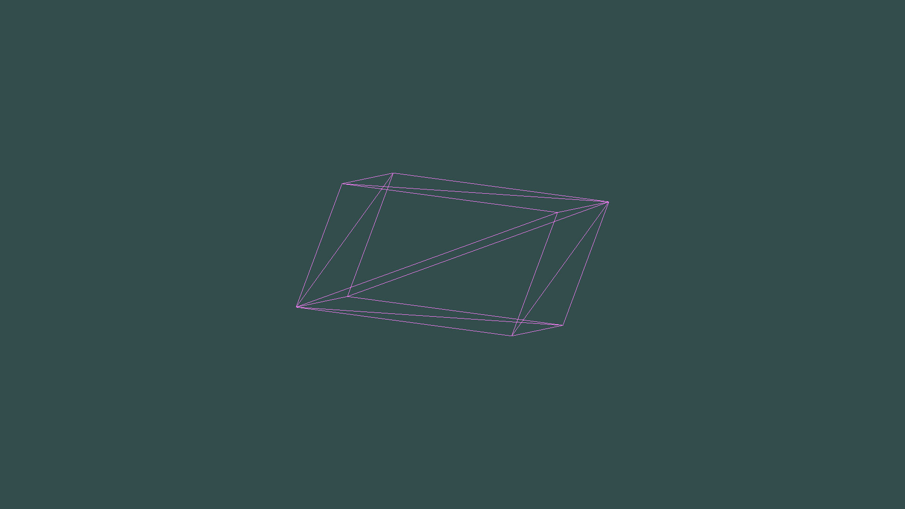
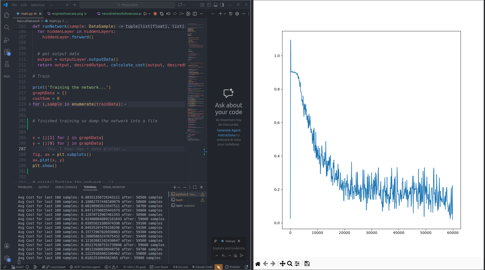

# PhysicsSim
Name suggests that this is just another physics engine and it is partially right.
Why partially? 
Well... this isn't just a game engine with physics simulation the main purpose of this project is to make
a ai character that can do a backflip.

## How is it going?
**[Full story on website](https://physics-sim-website.vercel.app/)**
### Engine
It is still in very early development(currently only spinning cube is working)

### Neural network
Since it is my first time making NN I started with MNIST dataset and right now it looks like this.

Later this will be adapted to take character and world parameters as a input and not image pixels

# Usage

## How to run (Linux)
- install glfw as you like xD
- use this to build: `g++ main.cpp vendor/glad/glad.c shaders/*.cpp buffers/*.cpp -o main -lglfw -lGL -g`
- run: `./main`

## How to run (windows)
**Idk since I don't have a windows**

## How to run (mac)
**Idk since I don't have a mac**